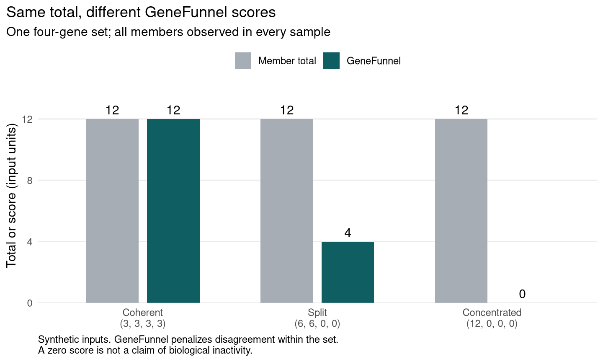

# GeneFunnel

GeneFunnel scores predefined gene sets in each sample of a non-negative
feature-by-sample matrix. Its Pietra-based penalty distinguishes equal member
values from abundance concentrated in a few members. Dense and sparse inputs follow the
same rules; implicit zeros count as observations.

The result is a gene-set-by-sample matrix with optional coverage diagnostics.
Scores do not establish biological activity or enrichment. Use a rank-based
method when relative ordering matters more than measurement scale.

## Article and reproducible evidence

The [article source](publication/article.Rmd), [HTML article](publication/article.html),
and [editable DOCX](publication/article.docx) describe the score and its evaluation.
The evidence includes independent perturbation data, public cohort analyses,
canonical scoring comparators, simulation ablations, and missingness stress.
It identifies limitations rather than claiming universal superiority.
Use the [publication reproduction guide](publication/README.md) to regenerate the results.

## Installation

The development package is not yet in Bioconductor. Install from GitHub with a
C++17 compiler available. The example figure also needs `ggplot2`.

```r
install.packages(c("BiocManager", "remotes", "ggplot2"))
BiocManager::install("eturkes/genefunnel")
```

## First result

After installation, run this from a writable folder. The bundled synthetic
example saves the figure below without downloading data.

```r
source(system.file("examples", "quickstart.R", package = "genefunnel",
    mustWork = TRUE))
```



Each sample totals 12, but scores fall from **12 to 4 to 0** as signal
concentrates in fewer members. Observed zeros are not missing values, and a
zero score does not prove biological inactivity.

The script prints a table and writes these files under `genefunnel-results/`:

| File | Contents |
|---|---|
| `comparison.png` | The labelled figure above, at 180 dpi |
| `scores.csv` | Each sample's total, score, observed count, and coverage |
| `gene-set-coverage.csv` | Declared and matched set sizes |
| `result.rds` | The full result, for `readRDS()` |

Re-running replaces these files. The script leaves `x`, `gene_sets`, `result`,
`score_table`, and `score_plot` in R. Edit the
[example script](inst/examples/quickstart.R) to change inputs or figures.

## Score your data

Replace `x` with a non-negative matrix whose rows name features and columns
name samples. Supply `gene_sets` as a named list of character vectors with
matching identifiers.

```r
library(genefunnel)

result <- genefunnel(
    x, gene_sets,
    BPPARAM = BiocParallel::SerialParam(),
    details = TRUE
)
result$scores
result$coverage
```

Inspect coverage: missing members can lower scores without a biological
difference. Use a justified common input scale; GeneFunnel does not correct
measurement scales or set sizes.

### Check coverage before scoring

Use `gene_set_coverage()` to inspect matching before choosing a coverage
threshold.

```r
library(genefunnel)

mat <- rbind(
    A = c(sample_1 = 4, sample_2 = 1),
    B = c(sample_1 = 4, sample_2 = 2),
    C = c(sample_1 = 4, sample_2 = NA)
)
gene_sets <- list(
    coherent = c("A", "B", "C"),
    partial = c("A", "B", "D"),
    insufficient = c("A", "Z")
)

coverage <- gene_set_coverage(gene_sets, rownames(mat))
coverage

# Example policy: at least 50% coverage and two matched members.
keep <- !is.na(coverage$coverage) &
    coverage$coverage >= 0.5 &
    coverage$matched_size >= 2

genefunnel(
    mat,
    gene_sets[keep],
    BPPARAM = BiocParallel::SerialParam()
)
#>          sample_1 sample_2
#> coherent       12        2
#> partial         8        2
```

For `sample_2`, GeneFunnel omits `C = NA` and scores `c(1, 2)`. Zeros remain
observed. Fewer than two observations produce `NA`.

### Enforce sample-level coverage

Global matching misses sample-specific gaps. Apply sample-level thresholds
when those gaps affect interpretation:

```r
checked <- genefunnel(
    mat,
    gene_sets[keep],
    BPPARAM = BiocParallel::SerialParam(),
    min_coverage = 0.8,
    min_observed = 2L,
    details = TRUE
)
checked$scores
checked$observed
checked$coverage
checked$set_coverage
```

Coverage is the observed count divided by the **unique declared set size**.
Unmatched members and missing cells reduce it; zeros remain observed.
Cells below either threshold become `NA` without removing their rows. These
filters neither rescale scores nor correct missingness bias.

Defaults of `min_coverage = 0`, `min_observed = 2L`, and `details = FALSE`
preserve the original score matrix and numerical results.

### Sparse matrices and parallel processing

Sparse matrices and portable parallel backends use the same API:

```r
sparse_mat <- Matrix::Matrix(mat, sparse = TRUE)
backend <- BiocParallel::SnowParam(workers = 2L, type = "SOCK")
scores <- genefunnel(sparse_mat, gene_sets[keep], BPPARAM = backend)
```

### Experiment containers

Pass a `SummarizedExperiment` directly and select the assay to score:

```r
se <- SummarizedExperiment::SummarizedExperiment(assays = list(signal = mat))
checked <- genefunnel(
    se,
    gene_sets[keep],
    assay = "signal",
    BPPARAM = BiocParallel::SerialParam(),
    details = TRUE
)
```

Omitting `assay` selects the only assay; multiple assays require an exact,
unambiguous name. Container names define feature matching and sample order.
The assay must be a supported numeric matrix. Sparse assays stay sparse;
delayed and disk-backed assays are rejected. Other assays and metadata remain
unchanged. The result is a score matrix or diagnostic list, not a container.

## Input assumptions

Matching is exact and case-sensitive. GeneFunnel does not preprocess, impute,
map identifiers, retrieve sets, test hypotheses, or interpret results.
Values must be non-negative with a meaningful zero. Adding a constant to
remove negative values changes the score and is unsuitable.

## Verification

Tests compare native implementations with an independent R calculation across
dense and sparse inputs, missingness, coverage, numerical extremes, and parallel
backends. They verify calculations, not biological performance.

From the repository root, run the same build and check used by CI:

```sh
Rscript tools/check-package.R
Rscript tools/check-package.R --bioc
```

Install dependencies first. The second command adds BiocCheck; logs remain
under `.checks/`. Both run examples, tests, and vignettes. CI targets Linux,
macOS, Windows, and Linux with R-devel; configured jobs are not evidence of
hosted passes.

## Further reading

- [Scoring specification](inst/SCIENTIFIC_SPEC.md) - equation, value and
  coverage rules, properties, and limitations.
- [Vignette](vignettes/genefunnel.Rmd) - worked examples and real-data studies:
  six-gene scores in GSE125583 and mouse brain pseudobulk profiles in GSE60361.
  Both extracts ship with the package; the analyses are descriptive.
- [Tests](tests/testthat) - reference calculations and implementation checks.

To read the rendered vignette, install suggested dependencies and build with
`build_vignettes = TRUE`, then run `vignette("genefunnel")`. The first-run
script needs no vignette build. Use `citation("genefunnel")` for citation details.

Regenerate the figure with `Rscript tools/render-quickstart.R`. Tests run the
same example and check its results and exports.

## License

GeneFunnel is licensed under GPL-3-or-later. See [COPYING](COPYING).
