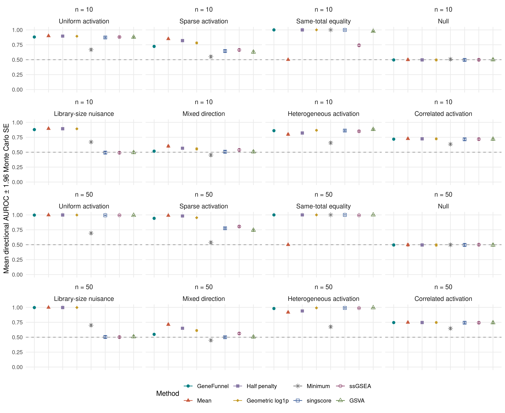
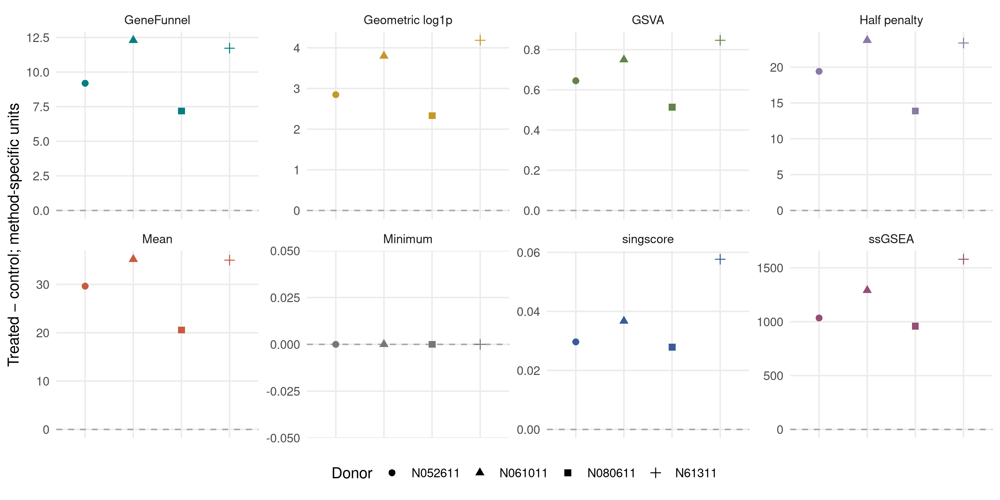
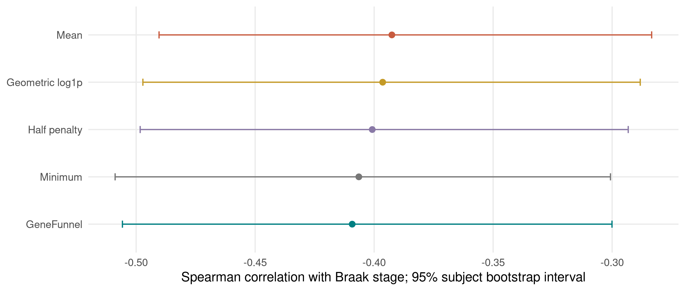

```{r setup, include=FALSE}
knitr::opts_chunk$set(echo = FALSE, warning = FALSE, message = FALSE)
read_result <- function(name) read.csv(file.path("results", paste0(name, ".csv")), check.names = FALSE)
sim <- read_result("simulation-summary")
ad <- read_result("ad-inference")
aw <- read_result("airway-summary")
coverage <- read_result("coverage")
mouse <- read_result("mouse-scale")
runtime <- read_result("runtime")
fmt <- function(x, digits = 3) formatC(x, digits = digits, format = "f")
ad_value <- function(metric, method = "GeneFunnel") ad[ad$metric == metric & ad$method == method, ]
ad_rho <- ad_value("rho")
ad_delta <- ad_value("rho", "Mean")
label <- function(x) gsub("_", " ", x, fixed = TRUE)
display_labels <- function(x) {
    fields <- intersect(c("method", "scenario", "mechanism", "preprocessing", "metric"), names(x))
    x[fields] <- lapply(x[fields], label)
    if ("metric" %in% fields) x$metric[x$metric == "rho"] <- "Spearman rho"
    x
}
sv <- function(scenario, method, size = 50) {
    sim$mean_auc[sim$scenario == scenario & sim$method == method & sim$size == size]
}
```

# Abstract

Gene-set summaries can preserve measured magnitude or emphasize relative rank.
GeneFunnel implements a non-negative total penalized by absolute deviation from the within-sample mean.
We show that the penalty equals a finite-size adjustment of the Pietra inequality index.
This identity defines the contribution as an interpretable implementation, not a new inequality measure.
We derive score bounds, monotonicity, concavity, and dominant-member plateaus.
The package exposes missing-member coverage and preserves dense, sparse, and parallel scoring semantics.
We evaluate eight simulated mechanisms, two set sizes, and 50 independent replicates per configuration.
Comparators include penalty ablations, singscore, ssGSEA, and GSVA.
An independent glucocorticoid signature provides a four-donor paired perturbation evaluation in airway smooth-muscle cells.
A six-gene Alzheimer cohort analysis estimates subject-level uncertainty and preprocessing sensitivity.
The GeneFunnel–Braak correlation is `r fmt(ad_rho$estimate)` (95% bootstrap interval `r fmt(ad_rho$low)` to `r fmt(ad_rho$high)`).
These experiments delimit the score's behavior; they do not establish universal superiority or pathway activation accuracy.
All analyses, numerical outputs, figures, and the manuscript regenerate from included inputs and documented dependencies.

**Keywords:** gene-set scoring; Pietra index; absolute deviation; missingness; R; transcriptomics.

# Introduction

Gene-set scoring reduces feature-level measurements to sample-level summaries.
The summary's meaning depends on its mathematical target, preprocessing, and feature coverage.
A rank score and a magnitude score need not agree, even when both implementations are correct.

GeneFunnel originated in a doctoral thesis [1].
It subtracts a disagreement penalty from the observed member total.
The intended interpretation combines abundance with within-sample equality.
That equality is not cross-sample coexpression, regulatory activity, or evidence of a causal mechanism.
This distinction is especially important when genes have different expected expression levels.

Independent sample scoring is an established design choice, including singscore [2].
GSVA estimates expression distributions across a cohort [3].
Its package also implements the rank-based ssGSEA method [4].
PLAID uses efficient sparse operations for mean-based scoring and also provides score normalization [5].
The arithmetic mean is therefore a necessary magnitude comparator.
A mean calculation here is an algebraic baseline, not an execution benchmark of the PLAID package.

This article contributes a transparent mathematical characterization, a coverage-aware implementation, and reproducible evidence about its useful and unsuitable regimes.
It makes no priority claim for an inequality measure.
It does not propose GeneFunnel as a universal replacement for enrichment analysis.

# Methods

## Score and estimand

For one gene set and one sample, let $x_1,\ldots,x_n$ be the observed, non-negative member values.
The observed count must satisfy $n\ge2$.
The score is

\[
F(x)=S-\frac{n}{2(n-1)}\sum_{i=1}^n|x_i-\bar{x}|,
\qquad S=\sum_i x_i,\quad \bar{x}=S/n.
\]

For $S>0$, the Pietra index is $H=\sum_i|x_i-\bar{x}|/(2S)$ [6].
Consequently,

\[
F(x)=S\left(1-\frac{n}{n-1}H\right).
\]

The all-zero case is defined directly as $F=0$.
The package returns $F$; comparator tables report $F/n$ to align its units with member means.
The mouse and coverage analyses retain native totals and label additional ratios separately.
The finite-size factor maps maximal concentration in one observed member to zero.
This is not the Gini coefficient, which uses pairwise absolute differences.

For fixed $n$, $F$ is symmetric, concave, and nondecreasing in every coordinate.
It satisfies $0\le F\le S$, positive homogeneity, and $F(x+c\mathbf{1})=F(x)+nc$ for $c\ge0$.
These properties follow from the proofs in Supplementary Methods.
They concern a fixed observed vector size, not deletion or addition of members.

The score can become insensitive to one dominant member.
For example, $F(1,1,M)=3$ for every $M\ge1$.
This behavior limits outlier influence but also discards genuine changes confined to that member.
The penalty rewards equal numerical values, not equal fold changes from different baselines.

## Implementation and observation policies

The R package accepts numeric base matrices, supported Matrix objects, and selected SummarizedExperiment assays.
A C++17 implementation uses a non-negative algebraic form to avoid cancellation near zero.
Sparse implicit zeros remain observed and contribute analytically.
BiocParallel schedules bounded column chunks.
The package performs no automatic normalization, identifier conversion, imputation, or hypothesis testing.

Gene sets are deduplicated and matched exactly to unique row identifiers.
`NA` and `NaN` are removed within each set–sample cell.
Missing rows, missing values, and measured zeros therefore remain distinct.
Scores require two observed members by default.
Optional observed-count and declared-set coverage thresholds return missing scores when their requirements fail.
Coverage filters do not estimate or repair the unobserved full-set score.

The score is sample-independent conditional on the supplied measurements and gene set.
A preprocessing operation that estimates reference values across samples need not have that property.
Comparisons require compatible measurement scales, feature definitions, and coverage policies.

## Computational evaluation

The fixed acceptance criteria and complete experiment definitions are included with the article.
The base analysis uses R's Mersenne–Twister generator, inversion normal generation, and rejection sampling with seed 7447.
No method, transformation, or signature is selected according to favorable results.
Numerically indistinguishable AUROC scores are tied after rounding to 12 significant digits.
This prevents floating-point residue from separating mathematically equal totals.

Each simulation configuration contains 50 independent replicates.
Each replicate has 500 genes and 80 samples, with 40 samples in each labeled group.
Target sets contain either 10 or 50 genes.
Baseline values follow a Gamma distribution with shape and rate equal to two.
The following mechanisms change the second group:

| Mechanism | Defined change | Evaluation target |
|---|---|---|
| Uniform activation | Multiply all target members by 1.5. | A broad magnitude increase. |
| Sparse activation | Multiply 10% of target members by six. | A localized magnitude increase. |
| Same-total equality | Target Gamma shapes are 0.5 versus eight; rescale each target total to its member count. | Equality at a fixed total; a construction probe. |
| Null | No group-dependent change. | Absence of designed separation. |
| Library-size nuisance | Multiply every gene by 1.5. | Sensitivity to an unwanted whole-sample scale factor. |
| Mixed direction | Multiply half the target members by 1.5 and divide the remainder by 1.5. | A bidirectional response that an unsigned score may miss. |
| Heterogeneous activation | Give each gene a persistent log-normal baseline, with log standard deviation 1.5; multiply target members by 1.5. | Unequal expected gene abundance. |
| Correlated activation | Multiply target profiles by a sample-specific log-normal factor, with log mean −0.08 and standard deviation 0.4; activate by 1.5. | Shared within-set variation. |

The simulation endpoint is directional AUROC: larger scores are assigned to the second group.
We do not flip unfavorable scores or report $\max(\mathrm{AUC},1-\mathrm{AUC})$.
A high nuisance-scenario AUROC is a failure to remove that nuisance, not a success.
An equality-scenario advantage demonstrates the formula's target, not biological correctness.
Null AUROC near 0.5 assesses directional discrimination, not formal type-I error control.

GeneFunnel is divided by the observed member count for scale reporting.
This leaves its AUROC unchanged within complete, fixed-size sets.
The arithmetic mean removes the entire penalty.
The half-penalty ablation averages the mean and GeneFunnel per member.
Additional baselines are the member minimum and $\exp[\operatorname{mean}\{\log(1+x_i)\}]-1$.
The latter includes a unit-dependent pseudocount and is not a zero-preserving geometric mean.

We run the published singscore implementation with average ties and an up-regulated signature.
The score is centered, and its direction is declared known.
We run ssGSEA through GSVA with exponent 0.25 and final range normalization disabled.
GSVA uses a Gaussian kernel, `maxDiff=TRUE`, and `absRanking=FALSE` on `log1p` measurements.
ssGSEA also receives `log1p` measurements; this monotone transformation preserves its ranks.
Each GSVA fit uses only one simulation replicate because its expression distributions depend on the cohort.
The independent rank methods are batched without cohort-level score normalization.
No runtime claim compares these algorithms' implementations.

We report mean AUROCs and Monte Carlo standard errors across independent replicates.
Paired GeneFunnel–comparator differences use the same generated datasets.
Their 95% intervals use a Student $t$ interval for the mean paired difference.
These intervals measure simulation precision under the stated generators, not uncertainty across biological populations.
They are pointwise, descriptive intervals; the benchmark makes no family-wise discovery claim.

## Coverage stress

We generate 300 complete, 20-member Gamma profiles.
Exactly 10%, 30%, or 50% of values are masked within every profile.
The masked members are random, lowest-valued, or highest-valued.
The latter two mechanisms deliberately depend on unobserved values.

We compare the incomplete score with its complete-data counterpart.
We also compare scores divided by observed count, using a common per-member reference.
Outcomes are median relative error, rank correlation, and retained profile counts at coverage thresholds zero, 0.8, and one.
This evaluates sensitivity to missing members, not a proposed correction for missingness.

## Independent perturbation evaluation

The `airway` dataset contains RNA-seq measurements from four human airway smooth-muscle donors, with matched untreated and dexamethasone-treated cultures [7].
The intervention label is external to gene expression.
The independent evaluation unit is the donor, giving four paired contrasts.

We freeze all 50 glucocorticoid-activated genes in Table 1 of Wang and colleagues [8].
That signature was identified and confirmed in A549 cells, independently of the airway dataset.
Its discovery involved dexamethasone and cycloheximide; confirmation included multiple time points.
The cell system and treatment context differ from airway smooth muscle.
Accordingly, this is a transfer evaluation, not an assumption that every member must respond identically.

Original labels are mapped to approved HGNC symbols and Ensembl identifiers using a checksum-pinned HGNC complete-set snapshot [9].
Ambiguous compound names use explicit source-defined rules.
The full source table, mapping recipe, compressed HGNC snapshot, and final mapping are included.
No response-dependent gene selection occurs.
The original table duplicates one GenBank accession for two labels; label-based mapping avoids treating that accession as unique.
The declared panel retains its pseudogene and all original members for coverage reporting.

Native Ensembl rows form the common background for every method.
Counts are converted to counts per million using the full assay library totals.
Constant CPM rows are removed independently of treatment labels.
The primary magnitude-scoring scale is CPM, with `log1p(CPM)` as a fixed sensitivity analysis.
GSVA receives `log1p(CPM)` once in both panels; the sensitivity analysis does not apply a second logarithm.
The two rank methods retain identical scores under the monotone transformation.
All methods score the same observed panel members and background.
We report every donor-level treated-minus-control difference, sign concordance, and exact binomial intervals.
Sign tests condition on non-tied pairs; all-tied methods have undefined sign intervals and tests.
The two-sided sign test cannot reach 0.05 with four concordant, non-tied pairs: its smallest possible $p$ is 0.125.
We therefore do not use this experiment to establish comparative superiority.

## Alzheimer cohort analysis

The bundled GSE125583 fixture contains 289 fusiform-gyrus samples: 219 Alzheimer cases and 70 controls [10].
Each sample represents a distinct recorded subject.
The panel is fixed as SYN1, SYN2, SYP, SNAP25, STX1A, and VAMP2.
It is an illustrative presynaptic panel, not a newly discovered signature or the source study's pathway analysis.

The primary preprocessing divides each gene's nRPKM by its control median.
Raw nRPKM and `log1p(nRPKM)` provide sensitivity analyses.
We compare GeneFunnel with the four magnitude-based baselines.
Rank methods are not applied to this six-gene fixture because it lacks the full transcriptomic background.

The primary association is Spearman correlation with recorded Braak stage.
It uses `r sum(!is.na(read_result("ad-scores")$braak))` subjects; covariate adjustment uses `r sum(complete.cases(read_result("ad-scores")[c("braak", "age", "sex")]))`.
We also report a partial rank correlation after adjusting ranked age and sex.
Complete observations are used separately for each endpoint.
Intervals use 2,000 subject-level bootstrap replicates, stratified by diagnosis.
Control-median preprocessing is re-estimated inside every bootstrap replicate.
Comparator differences use the same resampled subjects.
The intervals are conditional on the observed case–control counts.

Apparent diagnosis AUROC is descriptive and uses lower scores to indicate disease.
It is not held-out predictive performance: controls also define the expression reference.
We report no diagnostic threshold, calibration, clinical utility, or causal effect.
Missing covariates, cell composition, post-mortem effects, and unmodeled technical variables limit interpretation.
The fixture cannot support adjustment for unavailable covariates.

## Larger public matrix and computational measurements

GSE60361 supplies a mouse brain expression-scale example [11].
The fixture aggregates 19,972 endogenous genes into 47 subtype profiles from 2,816 annotated cells in seven broad classes.
It does not retain donor-level replication or cell-level counts.
We therefore report descriptive quantities without confidence intervals or class-prediction accuracy.

Genes are ranked by median broad-class CPM, with deterministic name-based tie breaking.
The top 500 and 5,000 genes form nested abundance panels, not pathways.
We compare subtype CPM with expression divided by the broad-class median reference.
These reference values use the same source cohort; they are not an external validation set.
We report totals, scores, and retained fractions for every subtype.

Runtime measurements use 5,000 features, 200 samples, and 200 sets containing 50 members.
Matrices have generated nonzero densities of 0.05, 0.5, and one.
Dense and sparse inputs represent the same values.
Each route is warmed once and timed seven times in serial execution.
We report elapsed-time ranges and stored input bytes, not peak memory, asymptotic scaling, or cross-package speed rankings.

# Results

## Algebraic checks and numerical semantics

The independent integer-grid oracle evaluates all vectors with entries from zero to three for sizes two through five.
It covers `r sum(unique(read_result("algebra")[c("n", "vectors")])$vectors)` vectors.
The largest observed identity or property violation is `r format(max(read_result("algebra")$maximum_error), scientific = TRUE)`.
The grid includes zeros, ties, concentrated profiles, and dominant-member plateaus.
Its equality-under-mixing check is a permutation-based concavity probe; the general proof does not depend on that grid.

The implementation's specification additionally distinguishes absent members, missing observations, and implicit sparse zeros.
The package tests cover numerical extremes, dense and sparse storage, observation policies, experiment containers, and parallel ordering.
The publication reproduction gate reruns deterministic tables and figures in a separate R process.

## Simulation exposes different targets

Figure 1 shows all mechanisms and both set sizes.
Table 1 gives the 50-member results; the supplement includes the 10-member results and paired differences.

```{r simulation-table}
methods <- c("GeneFunnel", "Mean", "singscore", "ssGSEA", "GSVA")
wide_auc <- function(size) {
    selected <- sim[sim$size == size & sim$method %in% methods, ]
    scenarios <- unique(selected$scenario)
    ans <- data.frame(Mechanism = label(scenarios))
    for (method in methods) {
        d <- selected[selected$method == method, ]
        d <- d[match(scenarios, d$scenario), ]
        ans[[method]] <- paste0(fmt(d$mean_auc), " ± ", fmt(d$mc_se))
    }
    ans
}
knitr::kable(wide_auc(50), col.names = c("Mechanism", methods), caption = "Table 1. Mean directional AUROC ± Monte Carlo standard error; 50-member sets, 50 replicates.")
```

```{r simulation-figure, fig.cap="Figure 1. Directional AUROC across simulation mechanisms. Facet labels indicate set size. Error bars show 1.96 Monte Carlo standard errors, not biological confidence intervals. Library-size separation is unwanted nuisance sensitivity. Same-total separation is an algebraic construction result.", out.width="100%"}

```

For 50-member sparse activation, GeneFunnel has mean AUROC `r fmt(sv("sparse_activation", "GeneFunnel"))`, compared with `r fmt(sv("sparse_activation", "Mean"))` for the mean.
Under the library-size nuisance, its AUROC is `r fmt(sv("library_size_nuisance", "GeneFunnel"))`, while singscore remains near chance at `r fmt(sv("library_size_nuisance", "singscore"))`.
This separation is an unwanted sensitivity to whole-sample scale.
With heterogeneous gene baselines, GeneFunnel reaches `r fmt(sv("heterogeneous_activation", "GeneFunnel"))`, versus `r fmt(sv("heterogeneous_activation", "GSVA"))` for GSVA.
A single ordering of methods is not an appropriate summary across these endpoints.
Uniform and sparse activation ask different questions from equality at fixed total.
The nuisance scenario explicitly separates magnitude preservation from scale invariance.
The heterogeneous and correlated scenarios challenge the common-baseline and independent-member assumptions.
The complete paired differences are retained, including unfavorable and inconclusive comparisons.

## Missingness changes the target

```{r coverage-table}
cov0 <- coverage[coverage$min_coverage == 0, c("missing_fraction", "mechanism",
    "median_raw_relative_error", "median_per_gene_relative_error", "rank_correlation")]
knitr::kable(display_labels(cov0), digits = 3,
    col.names = c("Missing fraction", "Mechanism", "Median relative error (total)",
        "Median relative error (per member)", "Rank correlation"), caption = "Table 2. Incomplete versus complete profiles without a coverage filter. Relative errors are signed.")
```

Dividing by the observed count does not remove value-dependent missingness bias.
A strict coverage policy replaces inadequate scores with missing values; it does not reconstruct complete profiles.
The supplement reports the corresponding losses in retained profiles.
These results support reporting observation counts alongside scores, especially when comparing samples with different coverage.

## Transfer to an independent glucocorticoid intervention

The observed airway scoring panel contains `r unique(aw$observed_genes)` of its 50 declared members.
The fixed mapping and assay-coverage table retain every original label.
Table 3 reports all methods and both preprocessing choices.

```{r airway-table}
knitr::kable(display_labels(aw[c("preprocessing", "method", "increased", "tied", "donor_pairs", "median_difference", "two_sided_sign_p")]),
    digits = 4, col.names = c("Scale", "Method", "Increased pairs", "Tied pairs",
        "Donor pairs", "Median paired difference", "Sign-test p"), caption = "Table 3. Independent glucocorticoid signature transfer. Differences use each method's own units and must not be compared across methods.")
```

GeneFunnel and every comparator except the minimum increase in all four donor pairs on both scoring scales.
The minimum remains zero, giving four ties.
The two-sided sign test is 0.125 for each non-tied method; these shared directions do not identify a superior scorer.

```{r airway-figure, fig.cap="Figure 2. Every donor-level contrast for the independent glucocorticoid signature, scored on CPM. Facets use method-specific vertical scales. All points represent paired biological donors; zero ties remain visible.", out.width="100%"}

```

The donor-pair table allows inspection of every directional disagreement.
Observed concordance concerns this intervention, tissue context, and externally defined signature.
Four donor pairs cannot establish a stable ranking of scoring methods or broad perturbation accuracy.
Differences between CPM and log-transformed results reflect a genuine change in GeneFunnel's estimand.
A monotone transformation preserves ranks but does not preserve absolute deviations.

## Disease association and preprocessing sensitivity

The primary GeneFunnel correlation with Braak stage is `r fmt(ad_rho$estimate)` (95% interval `r fmt(ad_rho$low)` to `r fmt(ad_rho$high)`).
The paired GeneFunnel-minus-mean correlation difference is `r fmt(ad_delta$delta_gf)` (95% interval `r fmt(ad_delta$delta_low)` to `r fmt(ad_delta$delta_high)`).
This difference compares association direction and magnitude, not causal relevance or predictive utility.

```{r ad-table}
a <- ad[ad$metric %in% c("rho", "partial_rank"), c("metric", "method", "estimate", "low", "high")]
knitr::kable(display_labels(a), digits = 3,
    col.names = c("Association", "Method", "Estimate", "95% lower", "95% upper"), caption = "Table 4. Braak-stage associations with subject-level bootstrap intervals. Partial rank correlation adjusts ranked age and sex.")
```

```{r ad-figure, fig.cap="Figure 3. Braak-stage associations for the fixed presynaptic panel. Intervals use 2,000 diagnosis-stratified subject bootstraps with reference scaling recomputed in each replicate.", out.width="90%"}

```

The complete preprocessing analysis is included in the supplement.
Differences among these estimates show that the score alone does not determine the result.
The data do not distinguish expression changes within cells from changes in tissue composition.
No new Alzheimer mechanism is inferred.

## Large-panel behavior and storage

```{r mouse-table}
mouse_summary <- do.call(rbind, lapply(split(mouse, list(mouse$panel_size, mouse$preprocessing)), function(z) {
    data.frame(panel_size = z$panel_size[[1]], preprocessing = z$preprocessing[[1]],
        profiles = nrow(z), median_retained_fraction = median(z$retained_fraction),
        minimum = min(z$retained_fraction), maximum = max(z$retained_fraction))
}))
rownames(mouse_summary) <- NULL
knitr::kable(display_labels(mouse_summary), digits = 3,
    col.names = c("Panel members", "Scale", "Subtype profiles", "Median retained fraction", "Minimum", "Maximum"), caption = "Table 5. Descriptive large-panel retained fractions. Subtypes are not independent biological replicates.")
knitr::kable(runtime[c("density", "storage", "median_seconds", "minimum_seconds", "maximum_seconds", "input_bytes", "max_absolute_difference")],
    digits = 6, col.names = c("Nonzero density", "Storage", "Median (s)", "Minimum (s)",
        "Maximum (s)", "Input bytes", "Maximum score difference"), caption = "Table 6. Serial runtime and stored input sizes for the fixed workload. Peak memory was not measured.")
```

Absolute scores inherit panel size and measurement units.
Dividing by the observed total yields a retained fraction, but changes the estimand from magnitude to inequality.
Dense and sparse calculations agree within the stated numerical tolerance.
These workloads establish reproducible functionality, not a general efficiency advantage.

# Discussion

GeneFunnel provides a direct summary when both total magnitude and numerical equality are scientifically relevant.
Its Pietra identity makes this assumption explicit.
The score is useful as an alternative representation, not as evidence that a gene set is active.

The dominant-member plateau is both a feature and a limitation.
It prevents one sufficiently large member from indefinitely driving the score.
It also makes the score insensitive to that member's further genuine activation.
Sparse biological responses can therefore favor a mean or rank-based summary.
Equal-total examples cannot determine which representation is biologically preferable.

Feature-specific expression baselines matter.
Genes can have unequal abundances while showing coordinated fold changes.
External scaling can change this behavior, but its reference and uncertainty become part of the method.
A control-derived reference is not automatic evidence of out-of-sample validity.
Likewise, sample-independent scoring does not remove batch effects or library-size differences.

Coverage diagnostics address an observable problem without solving an unidentifiable one.
Missing values do not reveal what the unobserved members would have contributed.
Value-dependent censoring can change both the effective set and its inequality.
Thresholds make the resulting exclusion policy auditable.
They must not be described as bias corrections.

The biological evidence remains deliberately bounded.
The airway experiment has an independent intervention and an external signature, but only four donors and one transfer context.
The Alzheimer analysis is observational and restricted to six genes.
The mouse fixture describes aggregated profiles without donor replication.
None supplies ground-truth pathway activity across many pathways or platforms.
A claim of broad superiority would require independently defined outcomes across additional perturbation cohorts and pathway collections.
That claim is not made here.

The comparator study includes canonical published implementations and transparent ablations.
It does not benchmark every scoring method, every normalization, or implementation-level speed across packages.
The primary contribution is a reproducible, numerically robust, coverage-aware realization of a clearly defined score.

# Availability and declarations

**Software and evidence.** The package source is available at <https://github.com/eturkes/genefunnel> under GPL version 3 or later.
The publication directory contains analysis code, inputs, results, figures, and this manuscript's source.
The reproduction entry point is `Rscript publication/reproduce.R`.
The package gate is `Rscript tools/check-package.R --bioc`.
The recorded environment identifies every loaded package version.
An immutable article-associated release and archive identifier must accompany a submitted version.

**Data.** Public accession identifiers, fixture build scripts, checksums, and original citations are included.
The two GEO fixtures reproduce byte-identically through their independent source-building recipes.
The independent glucocorticoid panel and the complete HGNC mapping snapshot are included.
The airway analysis uses the versioned Bioconductor dataset.
No new human samples or experiments are reported.

**Prior dissemination.** The score was described in the author's UCL doctoral thesis [1].
This article adds a corrected mathematical framing and reproducible evaluation.

**Author confirmation required before submission.** The final author list, affiliations, contributions, funding, competing interests, and applicable ethics wording require confirmation.
The prepared files are an article package, not a claim that peer review or journal publication has occurred.

# References

1. Turkes E. *Development of Gene Set Enrichment and Imputation Methods for Transcriptomics and Proteomics: Application in the Study of Neurofibrillary Tangle-bearing Neurons in Alzheimer's Disease*. PhD thesis, University College London. 2025. <https://discovery.ucl.ac.uk/id/eprint/10215006/>.
2. Foroutan M, Bhuva DD, Lyu R, Horan K, Cursons J, Davis MJ. Single sample scoring of molecular phenotypes. *BMC Bioinformatics*. 2018;19:404. <https://doi.org/10.1186/s12859-018-2435-4>.
3. Hänzelmann S, Castelo R, Guinney J. GSVA: gene set variation analysis for microarray and RNA-seq data. *BMC Bioinformatics*. 2013;14:7. <https://doi.org/10.1186/1471-2105-14-7>.
4. Barbie DA et al. Systematic RNA interference reveals that oncogenic KRAS-driven cancers require TBK1. *Nature*. 2009;462:108–112. <https://doi.org/10.1038/nature08460>.
5. Zito A, Escribà Montagut X, Scorici G, Martinelli A, Akhmedov M, Kwee I. PLAID: ultrafast single-sample gene set enrichment scoring. *Bioinformatics*. 2025;41:btaf621. <https://doi.org/10.1093/bioinformatics/btaf621>.
6. Porro F, Zenga M. Decompositions by sources and by subpopulations of the Pietra index: two applications to professional football teams in Italy. *AStA Advances in Statistical Analysis*. 2023;107:73–100. <https://doi.org/10.1007/s10182-021-00397-6>.
7. Himes BE et al. RNA-Seq transcriptome profiling identifies CRISPLD2 as a glucocorticoid responsive gene that modulates cytokine function in airway smooth muscle cells. *PLoS ONE*. 2014;9:e99625. <https://doi.org/10.1371/journal.pone.0099625>.
8. Wang JC, Derynck MK, Nonaka DF, Khodabakhsh DB, Haqq C, Yamamoto KR. Chromatin immunoprecipitation scanning identifies primary glucocorticoid receptor target genes. *PNAS*. 2004;101:15603–15608. <https://doi.org/10.1073/pnas.0407008101>.
9. HUGO Gene Nomenclature Committee. HGNC complete-set download. Source snapshot and SHA-256 are included in the supplement. <https://www.genenames.org/download/archive/>.
10. Srinivasan K et al. Alzheimer’s patient microglia exhibit enhanced aging and unique transcriptional activation. *Cell Reports*. 2020;31:107843. <https://doi.org/10.1016/j.celrep.2020.107843>. Whole-tissue companion cohort: <https://www.ncbi.nlm.nih.gov/geo/query/acc.cgi?acc=GSE125583>.
11. Zeisel A et al. Cell types in the mouse cortex and hippocampus revealed by single-cell RNA-seq. *Science*. 2015;347:1138–1142. <https://doi.org/10.1126/science.aaa1934>.

# Supplementary Methods and results

## Proofs

**Pietra identity and bounds.** Substitution gives $F=S[1-nH/(n-1)]$ for $S>0$.
At a fixed total, the absolute-deviation sum is convex on the non-negative simplex.
Its maximum occurs at a simplex vertex, where it equals $2S(n-1)/n$.
Its minimum is zero at the equal vector.
Substitution proves $0\le F\le S$.

**Concavity.** The mapping $x\mapsto x-\bar{x}\mathbf{1}$ is linear.
Its $L_1$ norm is convex.
Subtracting a non-negative multiple of this norm from the linear total gives a concave function.
Thus $F(tx+(1-t)y)\ge tF(x)+(1-t)F(y)$ for any non-negative vectors of the same size and $0\le t\le1$.
This result does not require member independence or a probability model.

**Non-negative calculation and monotonicity.** Let $L=\{i:x_i<\bar{x}\}$, $k=|L|$, and $B=\sum_{i\in L}x_i$.
The lower and upper deviations have equal sums, so

\[
F=\frac{(n-1-k)S+nB}{n-1}.
\]

Because $k\le n-1$, all terms are non-negative.
Within a region of fixed $L$, the derivative for a member outside $L$ is $(n-1-k)/(n-1)$.
For a member inside $L$, the derivative is $(2n-1-k)/(n-1)$.
Both derivatives are non-negative.
The score is continuous at region boundaries, so it is coordinatewise nondecreasing throughout its domain.
The derivatives lie between zero and two; coordinate changes cannot amplify the $L_1$ input distance by more than two at fixed $n$.

**Plateau.** If all members except one lie below the mean, $k=n-1$ and $F=nB/(n-1)$.
Further increases in the remaining member leave $B$ and therefore $F$ unchanged.
For $(1,1,M)$ with $M\ge1$, this gives $F=3$.

**Homogeneity and translation.** Scaling by $c\ge0$ scales the total and every absolute deviation by $c$.
Adding the same non-negative constant to all members changes the total by $nc$ and leaves every deviation unchanged.
Neither result justifies arbitrary shifts as preprocessing.

## Additional simulation and disease tables

```{r supplementary-tables}
knitr::kable(wide_auc(10), col.names = c("Mechanism", methods), caption = "Table S1. Mean directional AUROC ± Monte Carlo standard error; 10-member sets.")
knitr::kable(display_labels(read_result("ad-preprocessing")), digits = 3,
    col.names = c("Scale", "Method", "Spearman rho", "Partial rank", "Apparent AUROC"),
    caption = "Table S2. Fixed preprocessing sensitivity. Apparent AUROC is not held-out diagnostic performance.")
knitr::kable(display_labels(coverage[coverage$min_coverage > 0, c("missing_fraction", "mechanism", "min_coverage", "retained_profiles", "profiles")]),
    col.names = c("Missing fraction", "Mechanism", "Minimum coverage", "Retained profiles", "Total profiles"),
    caption = "Table S3. Coverage filtering changes retention, not the scoring equation.")
```

## Complete machine-readable supplement

`simulation-replicates.csv` contains every replicate-level AUROC.
`simulation-summary.csv` contains all paired GeneFunnel–comparator differences and their intervals.
`airway-pairs.csv` contains every independent donor contrast.
`airway-coverage.csv` contains every original signature label and its inclusion status.
`ad-inference.csv` contains all association and apparent-discrimination intervals.
`ad-scores.csv` contains public subject identifiers, covariates, and calculated scores.
`mouse-scale.csv` contains all descriptive subtype results.
`input-manifest.csv` identifies the exact data objects.
`replay.csv` records byte equality across independent analysis runs.
`environment.txt` records the R session.
`dependencies.csv` records exact loaded package versions.
`runtime-environment.txt` records the timing host and thread environment.

```{r input-manifest}
knitr::kable(read_result("input-manifest"), col.names = c("Input", "MD5"), caption = "Table S4. Analysis inputs and MD5 identities. Mapping provenance additionally records the HGNC SHA-256.")
```
